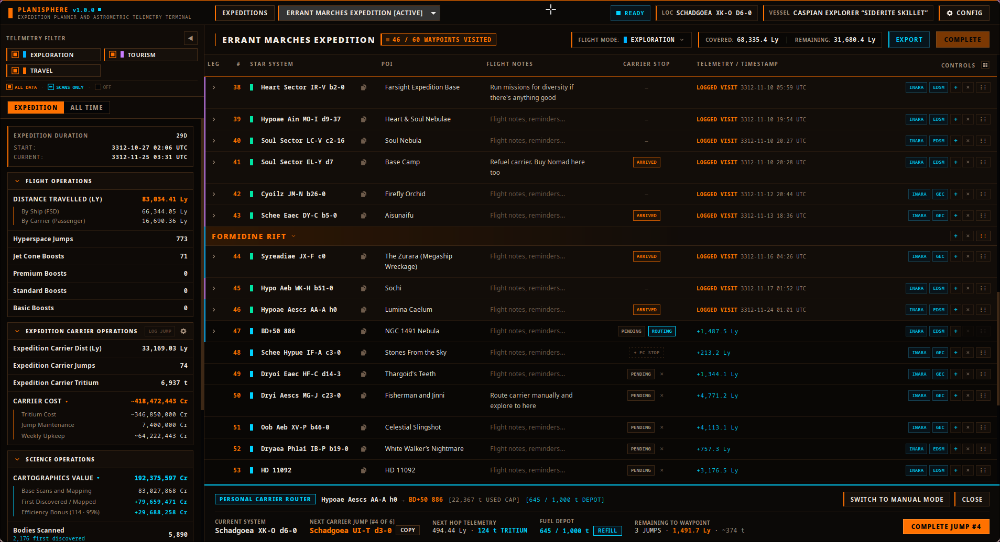

# Planisphere

Elite Dangerous expedition flight planner, fleet carrier router, and telemetry log.

> [!NOTE]
> This project was developed with help from AI.

---

Like the rest of you, I'm a nerd and I like stats. And while I'm not crazy enough to play Eve Online, I do have a few spreadsheets to my name. Planisphere used to be one of those and it worked wonderfully for me. Sure, it was manual labour planning and filling out the spreadsheet, but I loved it.

Then came the Caspian Explorer. Don't get me wrong, I love the thing, but it also unlocked a new possibility in exploration: figuratively coming home for Christmas. No longer did I have to stand by and watch everyone else participate in events and collect CG rewards. Within a few hours, I could make it back and participate myself.

This fucks the stats.

How do you reconcile tens of thousands of light years tacked onto the stats just from trips back and forth from the bubble? Want to know your average jump range on the expedition and see just how well economical routing did slowing you down? Too bad, because the average is inflated by your dipping of the Caspian in the jet cones for hours.

The solution to that problem was different flight modes with different stats, and even allowing scan data to bleed over (what, you've never stopped to check out an interesting system while buckyballing?) while flight stats stay in isolation. The problem with this solution is it suddenly becomes so tedious to set up that exploration is no longer fun.

That's where Planisphere comes in.




## Features

### Expedition Planning

Plan your route stop by stop without maintaining a spreadsheet on the side.

- **Multiple Expeditions and Bulk Import:** Track multiple expeditions at once, clone existing routes into fresh trips, or bulk-import waypoints from a pasted system list, `.txt` file, or Spansh `.csv` export.
- **Waypoints, Regions, and POIs:** Organize stops with notes and Region Headers. Coordinates, galactic regions, and visit counts resolve from your local journals first with EDSM as a fallback, alongside automatic EDAstro GEC/GMP badges and configurable links to Inara, EDSM, and GEC.
- **Retroactive Start and Live Progression:** Start an expedition from a past visit to Waypoint #1 to replay your flight history, or launch fresh. As you fly, Planisphere watches your journal and advances through stops automatically.
- **Live Route Editing:** Insert, reorder, or remove waypoints mid-expedition. Planisphere keeps your visited history intact while letting you slot in missed stops or rework the unvisited route ahead.
- **Per-Leg Telemetry:** Expand any visited leg (or the active leg) to inspect its travel time, jumps, ships flown, scans, and estimated vs. realized earnings. Expanding Waypoint #1 shows your pre-expedition baseline.
- **In-Game Playtime Tracking:** Reconstructs your actual in-game play time for the active expedition, each leg (split into non-overlapping In-Transit and In-System durations), your pre-expedition baseline, and your all-time career. Switch Config between `Calendar` and `In-Game` duration display anytime, and hover any duration to see the alternate value in a tooltip.
- **Session Undo and Redo:** Press `Ctrl+Z` (`Cmd+Z` on macOS) outside text inputs to undo recent route edits, flight mode changes, Fleet Carrier plotter actions, and expedition lifecycle changes, and press `Ctrl+Y` or `Ctrl+Shift+Z` (`Cmd+Shift+Z`) to redo them.
- **Waypoint and Visit Search:** Search star systems and POI names across all saved expeditions from the top bar, or click any green visited-system indicator to inspect its journal visit history (including non-waypoint visits) and jump straight to the matching stop.
- **Live Sync Pause:** Pause live journal watching from the top bar anytime without losing incoming events; queued writes ingest in order when you resume.

### Flight Modes

When an expedition spans months, you don't always fly the same way. Flight Modes let you separate your stats per leg depending on what you're doing in the cockpit.

- **Per-Expedition Leg Modes:** Each expedition tracks its own active flight mode and stamps every visited leg independently, so overlapping expeditions never bleed into each other. Flip modes when you race back to the Bubble so neutron highway sprints don't skew your expedition's average jump range or mileage.
- **Partial Filtering:** Toggle any mode in the Telemetry Filter between full inclusion, scan-only inclusion, or complete exclusion. Scan-only mode lets discoveries count toward your wallet while keeping travel stats isolated.
- **Per-Leg and Cascade Editing:** Reclassify any individual leg from its telemetry drawer, or cascade a mode across all subsequent visited legs to clean up multi-phase trips in a few clicks.
- **Custom Flight Modes:** Define your own modes in Config with custom names, descriptions, and colour tags.

### Exploration Valuation and Realized Earnings

See what your discoveries are worth as you scan them, and track what actually hits your bank account when you cash in.

- **Live Cartography Estimates:** Values FSS scans and Horizons or Odyssey DSS surface mapping as they happen, including terraformable, First Discovery, First Mapped, and efficiency bonuses.
- **Live Exobiology Estimates:** Values organic species sampled in your Artemis suit, including the First Logged bonus on untouched worlds.
- **Realized Earnings Breakdown:** Compares your estimated survey value against the net credits you actually pocket at Universal Cartographics and Vista Genomics, breaking out losses from death, stolen bonuses, the 25 percent Fleet Carrier tariff, and NPC crew cuts.
- **Expedition and All-Time Scopes:** Switch the telemetry sidebar between your active expedition (with flight mode filters) and your all-time career totals, with travel distance split between ship FSD jumps and carrier passenger rides.

### Fleet Carrier Routing

Whether you're taking your own carrier into the black, flying with a squadron, or hitching a ride, carrier jumps are built right into the planner.

- **Interactive Spansh Router with Depot Control:** Flag any waypoint as a Carrier Stop to plot 500 Ly hops with `[ICY RING]` mining indicators and live fuel depot tracking. Planisphere recalculates tritium burn from your actual depot level as you drain and refill it, fixing stock Spansh's fuel under-estimates with accurate per-jump math.
- **Personal and Squadron Carriers:** Supports both Personal (`25,000 t`) and Squadron (`60,000 t`) carriers when plotting routes and estimating tritium burn.
- **Manual Jump Logging:** Switch to manual mode or log unscheduled carrier jumps directly from the sidebar without needing a planned Carrier Stop.
- **Expedition Carrier Costs:** Tracks overall carrier operating costs for an expedition across tritium, jump maintenance, and pro-rated weekly upkeep.

### Commander Save Slots

Fly multiple accounts, rename your commander, or start fresh after a save wipe without tangling your routes and career totals together.

- **Automatic Save-Slot Separation and Renames:** Separates alt accounts, cleared saves, Legacy 3.8, and Beta servers into distinct save-slot profiles while keeping Frontier Store character renames unified under one career. Config lists historic names with individual event counts, while exports show only your current name.
- **Per-Expedition Save Slot:** Each expedition tracks a single commander save slot, automatically defaulting to your most recent commander with the option to switch save slots when starting or editing an expedition if you fly multiple profiles.
- **Career and Baseline Scope:** Choose in Config whether Sidebar All-Time, Waypoint #1 Origin Baseline, and Export Career Diff totals follow your active expedition's commander save slot or all enabled save slots.
- **One-Time Manual Overrides:** Merge profiles after a rename, separate linked aliases, split a career at a save-wipe date (down to the exact `LoadGame` session), or reset back to auto-detection in Config.

### Expedition Export

Share finished or in-progress journeys as cockpit telemetry cards, offline HTML reports, or raw JSON archives.

- **Export Studio and Quick Share:** Open Export Studio on any departed or completed expedition to assemble `Summary`, `Details`, `Waypoints`, and `Highlights` blocks with live preview, or use the preloaded `Quick Share` preset to export right away.
- **Flexible Scopes and Breakdowns:** Slice stats by full expedition, pre-expedition baseline, individual or all legs, or galactic regions, either combined or split by flight mode. Pick individual metrics across six detail categories or surface `Top 1`, `Top 3`, or `Top 5` leg and waypoint leaderboards.
- **PNG, HTML, and JSON Outputs:** Independently toggle 2x DPI PNG cards, a single-file print-ready offline `.html` report, and a complete unfiltered `.json` snapshot.


## Installation

### Prebuilt Packages

Prebuilt binaries are available under [GitHub Releases](https://github.com/amot-dev/planisphere/releases):
- **Linux**: Standalone AppImage and tarball
- **Windows**: NSIS setup installer and portable zip

### Arch Linux (AUR)

Planisphere is available on the Arch User Repository (AUR) as [`planisphere-bin`](https://aur.archlinux.org/packages/planisphere-bin):

```bash
yay -S planisphere-bin
# or
paru -S planisphere-bin
```

### Building from Source

Planisphere builds from source as a native desktop binary using Go, Wails, and React.

#### Prerequisites

- **Go**: 1.26 or newer
- **Node.js**: 20+ or 22+ and `npm`
- **Wails CLI v2**:
  ```bash
  go install github.com/wailsapp/wails/v2/cmd/wails@latest
  ```
- **C compiler and development headers**:
  - **Debian / Ubuntu**: `sudo apt install libgtk-3-dev libwebkit2gtk-4.1-dev build-essential`
  - **Fedora**: `sudo dnf install gtk3-devel webkit2gtk4.1-devel gcc-c++`
  - **Arch Linux**: `sudo pacman -S gtk3 webkit2gtk-4.1 base-devel`
  - **Windows**: [WebView2 runtime](https://developer.microsoft.com/en-us/microsoft-edge/webview2/) (preinstalled on Windows 10/11) and a C compiler (such as `gcc` via MinGW-w64 or [w64devkit](https://github.com/skeeto/w64devkit))

#### Build Steps

1. Clone the repository:
   ```bash
   git clone https://github.com/amot-dev/planisphere.git
   cd planisphere
   ```

2. Build the application:
   ```bash
   make build
   ```

3. Run the application:
   ```bash
   make run
   ```

### First-Launch Setup

Everything in Planisphere lives in a local SQLite database on your machine: your journals, routes, and cached coordinates stay local and work offline. Planisphere never modifies your game files.

- **Database Location:** Choose where `planisphere.db` is stored during first-launch setup. To move or repoint your database later while Planisphere is closed, you can update `"dbPath"` in `bootstrap.json` (`~/.config/Planisphere/bootstrap.json` on Linux, `%APPDATA%\Planisphere\bootstrap.json` on Windows, or `~/Library/Application Support/Planisphere/bootstrap.json` on macOS).
- **Journal Directory:** Point Planisphere to your Elite Dangerous journal directory on first launch. It ingests your existing `Journal.*.log` files and watches the folder for live events while you fly.
- **Optional EDDiscovery Backfill:** If your older raw journal files have been purged or archived, Planisphere can recover past flight history from an existing EDDiscovery database (`EDDUser.sqlite`) during setup or later in Config.

> [!WARNING]
> The Elite Dangerous journal directory must reside on a local drive and exist prior to starting Planisphere. Remote network shares (NFS, SMB/CIFS) and non-existent directories do not emit kernel filesystem notifications and are not supported for live telemetry.

### Updates

Planisphere checks GitHub Releases for newer versions on startup, even when **Online Services** is turned off in Config.


## Design Choices

### Route Progression and Waypoint Boundaries

- **Sequential Progression and Loop-Route Safety:** Planisphere only auto-completes the immediate next unvisited waypoint when a journal arrival is logged after the previous waypoint's timestamp. Jumping into a stop further down your list never auto-shuffles your route. That keeps loop expeditions, carrier hub setups, and repeat visits from prematurely collapsing future return stops into earlier legs.

- **Departure-Gated Legs and Waypoint #1 Start:** Every visited waypoint tracks both its arrival and your first physical departure to another star system. A destination waypoint's drawer runs from departing the previous stop through departing the destination itself, so scans collected inside a waypoint stay in that waypoint's drawer and leg durations add up cleanly to the expedition total. While you are still exploring a newly reached waypoint, it stays open as your live `IN SYSTEM` drawer until you jump out.

  Expedition telemetry, duration, and pro-rated carrier upkeep start on your **first departure from Waypoint #1**, not on arrival. That keeps outfitting and staging inside Waypoint #1's pre-expedition baseline and avoids double-counting when chaining expeditions from a shared hub. (If you want discoveries inside an unexplored starting system counted in the expedition, set the system right before it as Waypoint #1.)

  A waypoint's stay closes on your first departure out of that system so later detours never drag unrelated travel back into an earlier leg. Completing an expedition locks its end time to the final waypoint's last in-system exploration activity (`Scan`, `SAAScanComplete`, or `ScanOrganic`, excluding asteroid belt clusters), falling back to arrival if none occurred. If you leave the final stop for a side-trip and return to keep scanning, add a repeat waypoint row for the return visit.

  *Tip for mode switches:* Because in-system exploration inherits its incoming leg's Flight Mode, place a waypoint in the system right before a POI if you want to sprint there in `Travel` mode and switch to `Exploration` before entering.

- **Chronologically Bounded Waypoint Reordering:** During an active expedition, you can insert, reorder, or remove waypoints on the fly (except Origin Waypoint #1 and any active Spansh carrier target). Once a waypoint is visited, marked `ARRIVED` as a carrier stop, or targeted by an active Spansh route, its star system locks while notes and POI names stay editable.

  Dragging a waypoint checks candidate slots against your journal history: dropping it between two visited stops (or right after the last visited stop) binds the earliest recorded arrival in that time window, while dropping it below all visited stops clears its visit timestamp and moves it back to the unvisited plan.

### In-Game Playtime Reconstruction

- **Session-Interval Reconstruction and Crash Resilience:** Frontier does not log a play-time delta on every jump or waypoint, so Planisphere reconstructs contiguous in-game sessions from `LoadGame` through `Shutdown` or a return to `MainMenu` (`Music` track changes), carrying sessions across multi-part journal rollovers. When Elite crashes or disconnects without writing `Shutdown`, Planisphere anchors the unclosed session against your last logged event and reconciles missing tail time from subsequent `Statistics` `Time_Played` jumps without ever overlapping the next session.

- **Codex AFK Semantics and Additive Leg Splits:** Frontier's in-game Codex `Time_Played` counter ticks whenever your commander is loaded into the galaxy, including time spent docked or AFK while logged in. Planisphere matches that convention so expedition and all-time totals stay consistent with your Codex. Each leg splits reconstructed session overlap at your waypoint arrival timestamp into non-overlapping **In Transit** (departure from the previous stop to arrival) and **In System** (arrival to departure) durations so leg totals add cleanly to your full expedition play time.

- **Minimum Duration Guards for Daily and Hourly Rates:** Short sprints can turn small denominators into wildly inflated averages, so Export Studio withholds rate metrics until a scope clears a minimum time floor. Daily averages (`Avg Distance per Day` and `Avg Credits per Day`) require at least 24 hours of elapsed calendar time, while hourly pace metrics and the `Highest Earning Pace` highlight require at least 1 hour of in-game play time (and `Fastest Transit Pace` requires at least 1 hour of in-transit play time). Scopes below those thresholds hide or disable the affected metrics instead of extrapolating a brief leg into distorted daily or hourly rates.

### Galactic Regions and Coordinate Resolution

- **Deterministic Region Lookup:** Elite Dangerous omits galactic region names from `FSDJump`, `Location`, and `CarrierJump` events (only logging `Region` inside `CodexEntry`), and EDSM's system endpoint omits them too. Because Frontier defines the 42 Codex regions on a fixed 2048 by 2048 2D grid across the `(X, Z)` galactic plane (`83 / 4096` pixels per light year, about `49.35 Ly` per cell), Planisphere computes each waypoint's region directly from its coordinates as soon as they are known.

- **Manual Region Headers:** Even though every resolved waypoint knows its region, Region Header rows stay under your control rather than auto-inserting. That stops rows from jumping around while coordinates resolve in the background, avoids header spam when a route skims a region border, and lets you lay out region headers top-down as chapters before picking specific systems.

- **Visit Counting Without Relog Inflation:** Coordinate indicators count completed system entries (`FSDJump`, `CarrierJump`, and verified disconnect/offline-carrier recoveries, with a minimum of `1 Visit` if a system was only seen via `Location`). Logging out and back in at a parked station or carrier won't inflate your visit count, and indicators only refresh on arrival events or commander filter changes rather than on every body scan.

### Estimated vs. Realized Value

Planisphere tracks two separate credit numbers: what your scans were worth on paper when you took them (**Cartographics Value** and **Exobiology Value**), and the **net credits you actually pocketed** (**Realized Value**).

- **Scan-Time Attribution:** When you cash in exploration data, the payout and any deductions (tariffs, crew wages, stolen bonuses, or death losses) are credited back to the **leg and flight mode where each scan was originally taken**, not dumped onto whichever leg is active when you dock. Sales with no matching prior scan fall back to the sale timestamp.

- **Universal Cartographics vs. Vista Genomics:** `SellExplorationData` and `MultiSellExplorationData` log `TotalEarnings` already net of both the 25 percent Fleet Carrier tariff and hired NPC crew cuts. `SellOrganicData` logs gross `Value + Bonus` before crew wages, so Planisphere subtracts matched `NpcCrewPaidWage` events logged within five seconds of the sale.

- **Reading the Loss Sublines:** Every subline under `Realized Value` (`Cartographics Lost (Death)`, `Exobiology Lost (Death)`, `Cartographics Stolen`, `Exobiology Stolen`, `Carrier Tariffs`, and `NPC Crew Payouts`) is an **informational breakdown of money already missing from `Realized Value`**, not an extra fee to subtract again. Once everything is sold, `Realized Value` lands within 1 to 2 percent of `(Cartographics Value + Exobiology Value) - Sum(Sublines)` due to Elite's mass-curve rounding. Any larger gap is unsold data still sitting on your ship or suit.

### Valuation Rules, Historical Eras, and Community Goals

- **Populated Systems and Tag-Locked Bubble Worlds:** In inhabited systems (`Population > 0`), Elite disables First Discovered, First Mapped, and First Footfall tags in-game, yet still writes `WasDiscovered: false` and `WasFootfalled: false` in `Scan` events. Pre-seeded Bubble bodies can also log `WasDiscovered: false` alongside `WasMapped: true`. Planisphere filters out populated systems and tag-locked bodies so flying through the Bubble doesn't pad your stats with impossible first-discovery bonuses.

- **Horizons vs. Odyssey Mapping Payouts:** Odyssey adds a 30 percent bonus to DSS mapping (`SAAScanComplete`) over Horizons. Planisphere tracks your `LoadGame` state (`Odyssey: true` or `false`) across your timeline so old Horizons scans use the Horizons formula and Odyssey sessions get the 30 percent bonus.

- **Pre-Update 14 Exobiology:** Before Update 14 (`2022-11-29T08:00:00Z`), Vista Genomics used lower base values and a `2x` First Logged multiplier instead of `5x`. Frontier pays out using the table active when you sell, not when you scan. Planisphere matches that: sold samples use the sale timestamp's era rules (so pre-Update 14 samples sold afterward get modern payouts), while unsold or lost samples use the scan timestamp.

- **Community Goals:** Temporary event payout multipliers are **not** auto-detected; they are added in code after an event finishes and its payout rules are verified. For example, Planisphere includes a rule for the November 2025 `HIP 87621` Exobiology Initiative (`8x` base value = `952,296 Cr` per `Radicoida Unica` sample sold at `Exogene Sciences`, handling Vista Genomics' multi-sample batch aggregation). For any uncurated Community Goal, estimates use standard pricing while `Realized Value` still reflects the actual credits paid.

### Death and Respawning

Elite's journals never erase past entries, and neither does Planisphere. If you die on foot or lose your ship, your collected scans and theoretical values stay in your history, and respawning won't inflate your jump distance or advance your waypoints.

Under realized accounting, unsold data is marked lost when your `Resurrect` event is logged (not while sitting on the `Died` screen), split by how you died:

- **On-Foot, SRV, or Nomad Death:** Dying on foot or wrecking a Scarab, Scorpion, or ship-launched Nomad marks only unsold suit exobiology as lost (`Exobiology Lost (Death)`). Shipboard cartography stays pending. Losing an unoccupied parked SRV or Nomad while alive on foot does not log `Resurrect` and loses no data.

- **Ship Destruction:** Losing your main ship marks both unsold suit exobiology and unsold shipboard cartography as lost.

- **Re-Sampling and Re-Scanning After Death:** Elite locks the Genetic Sampler for a species on a body until that sample is sold or wiped by death, so every completed `ScanOrganic` analysis is a distinct physical sample. If you crash an SRV, redeploy, and re-sample the same species, both attempts count toward `Organic Samples` and `Exobiology Value`, while the lost attempt lands in `Exobiology Lost (Death)` so `(Exobiology Value - Exobiology Lost (Death))` still reconciles with `Realized Value` when you sell. By contrast, Elite re-emits body `Scan` events freely across sessions without death or sale, so `Cartographics Value` counts each body once while `Cartographics Lost (Death)` and `Realized Value` still track a lost scan and any later re-scan sale.

### Fleet Carrier Mechanics

- **Tritium Math vs. Stock Spansh:** Planisphere uses Spansh to find the 500 Ly route hops, then discards Spansh's fuel numbers. Stock Spansh assumes an artificially low tritium level in your carrier's depot, which under-reports actual burn because depot fuel adds mass to the carrier. Planisphere recalculates every hop with Elite's in-game formula (`round(5 + distance * (usedCapacity + depotTritium + 25000) / 200000)`) using your actual depot level (up to `1,000 t`), updating remaining costs as the depot drains or refills.

- **Passenger Rides vs. Carrier Operations vs. All-Time Totals:** Elite only writes a `CarrierJump` event when you are docked aboard the carrier during the jump, missing remote jumps ordered from your ship and Squadron Carrier jumps made while you are elsewhere. To avoid missing remote jumps or double-counting rides, Planisphere separates them into three buckets:
  - **By Carrier (Passenger)** (under `Distance Travelled (Ly)`) tracks `CarrierJump` events and recovered offline carrier rides where you personally rode aboard, obeying flight mode filters.
  - **Expedition Carrier Operations** (Carrier Dist, Carrier Jumps, and Tritium) tracks jumps logged via the carrier router and manual jump logger, independent of flight modes.
  - **All-Time Personal Carrier Operations** reads your owned carrier's lifetime jump count and distance from Frontier's `Statistics` event (`FLEETCARRIER_TOTAL_JUMPS` and `FLEETCARRIER_DISTANCE_TRAVELLED`). Tritium and Carrier Cost are omitted on the All-Time tab because neither `Statistics` nor `CarrierJump` logs lifetime fuel burn, commissioning date, or upkeep paid.

- **Carrier Arrival Frontier and Stop Ordering:** Carrier stops (`PENDING` and `ARRIVED`) track their own frontier (the latest `ARRIVED` stop) instead of locking when your ship jumps ahead. You can add carrier stops after the last `ARRIVED` stop even if your ship already visited the system, and remove any `PENDING` stop (subject to active route locks). Reordering blocks moving a `PENDING` stop above an `ARRIVED` stop or active Spansh target (`FC STOP ORDER BLOCKED`), while dragging an `ARRIVED` stop below a `PENDING` stop asks for confirmation before resetting it to `PENDING`. If a stop ever falls out of sync with your carrier in-game, clicking an unlocked badge opens a cascading override to keep the frontier contiguous.

- **Static Weekly Upkeep:** Expedition carrier upkeep uses a single static weekly rate per expedition, pro-rated continuously over the expedition's elapsed duration. Carrier services can only be installed or removed at Carrier Administration systems in the Bubble or Colonia, so your upkeep rate doesn't change out in deep space anyway.

### Commander Save Slots and Career Continuity

- **Save-Slot and Rename Resolution:** Planisphere resolves save slots from galaxy server headers (`Fileheader` version and build fields distinguishing Live, Legacy 3.8, and Beta) and your Frontier account `FID`, carrying identity forward across multi-part `Continued` log rollovers and bridging older pre-`FID` logs when a name maps unambiguously to one Live `FID`. Frontier Store character renames share the same `FID` and stay unified under your current name, while cleared saves split into archived `PRE-WIPE` eras via `ClearSavedGame`, `NewCommander`, and steep drops in `Statistics` exploration counters (`Systems_Visited` and `Total_Hyperspace_Jumps`).

- **Rescan-Safe Manual Overrides:** Manual Merge, Separate, and Split actions in Config are stored as declarative override rules rather than one-off edits to past journal rows. Full journal rescans and EDDiscovery imports replay those rules automatically so your customizations survive intact.

### Disconnect Recovery and Non-Ship Travel

- **Mid-Jump Disconnects:** When Elite throws an Orange Sidewinder, Mauve Adder, or Taupe Cobra mid-hyperspace, Frontier's servers still finish the jump and add it to your lifetime `Statistics`, while the client closes before writing an `FSDJump`. On your next login, if a jump-capable ship spawns undocked in space via `Location` in a new system and the prior session had a matching hyperspace `StartJump` to that exact system, Planisphere recovers the jump count, exact 3D distance, visit count, and leg vessel history automatically. Any armed `JetConeBoost` or FSD injection `Synthesis` from that uninterrupted stay is credited too. If no matching `StartJump` exists (such as playing across two unsynced PCs), Planisphere does not guess.

- **Offline Carrier Rides:** If you disconnect during a carrier jump or log out aboard a carrier that jumps while you are offline, Frontier logs a `Location` in the new system instead of a `CarrierJump`. Whenever you stay continuously docked or on foot in the concourse aboard the same carrier with no intervening undock, jump, or respawn, Planisphere credits the straight-line 3D chord between logout and login to **By Carrier (Passenger)** and **Distance Travelled (Ly)** (obeying flight modes) without counting a piloted ship jump.

- **Shuttles and Multicrew:** Telepresence (`Multicrew: true`) never moves your physical commander, so Planisphere ignores it completely across arrivals, visits, jumps, distance, and vessel history. Apex Interstellar shuttles (`Taxi: true`) physically relocate your commander, so they count for arrivals, departures, location, and visit counts, but are excluded from `Hyperspace Jumps`, `By Ship (FSD)`, `Distance Travelled (Ly)`, and leg vessel history because Elite Dangerous's own stats don't count Apex shuttle distance.

### Elite Dangerous Journal Limitations

A few journal quirks can't be reconstructed reliably from Frontier's logs. Planisphere intentionally avoids guessing on these rather than inventing phantom losses:

- **Exobiology First Logged Detection ([Frontier Issue #81891](https://issues.frontierstore.net/issue-detail/81891)):** Journals don't reliably set `WasLogged` on `ScanOrganic` when another commander already logged a species. Planisphere checks `WasFootfalled == false` on the parent body's `Scan` event instead (falling back to `!WasDiscovered` and `!WasMapped` on pre-2025 logs). If another commander got First Footfall without sampling the organics, those samples estimate at `1x` until you sell them at Vista Genomics, where they upgrade to `5x` automatically. If you die before selling on a previously footfalled world, lost samples can only be valued at `1x`.

- **Stolen Bonuses on Bulk `MultiSellExplorationData` Sales:** Unlike single-system `SellExplorationData` (which lists `Discovered` bodies), bulk `MultiSellExplorationData` bakes First Discovery and First Mapped bonuses straight into `BaseValue` and uses `Bonus` only for flat system-completion bonuses. Because per-body discovery flags are missing, Planisphere cannot detect stolen bonuses on bulk sales and won't infer them from `Estimated - BaseValue`, which naturally drifts by 1 to 2 percent from mass-curve rounding and passive star/belt honks.

- **Unlogged Vista Genomics NPC Crew Cuts:** Frontier occasionally takes a hired NPC pilot's cut from Vista Genomics payouts without writing an `NpcCrewPaidWage` event. Planisphere only deducts explicitly logged `NpcCrewPaidWage` events within five seconds of a sale instead of guessing from `Statistics` deltas, which mix combat, trade, and exploration crew wages together.

- **Detention Ship Impounds and Unmanned Mothership Rebuys:** When your ship is impounded after an on-foot bounty death, or an unmanned mothership is destroyed while you are on foot, in an SRV, or in a Nomad, Odyssey keeps your shipboard cartography intact yet still logs `Resurrect` with `Option: "rebuy"` and a positive `Cost`, identical to a manned ship loss. Planisphere logs pending cartography under `Cartographics Lost (Death)` on `rebuy` and does not retroactively clear it if those systems later appear in `MultiSellExplorationData` (which would erase real ship-destruction losses whenever you passively honk a system on the way back). When that surviving data is sold, the payout still lands in `Realized Value`.

- **Voluntary Starter Sidewinder Forfeit:** If you can afford your rebuy (`Bankrupt: false`) but voluntarily forfeit your ship for a free Sidewinder and Elite logs `Option: "free"` with `Cost: 0` instead of `"freewinder"`, the journal makes it indistinguishable from a free on-foot redeployment to orbit.

- **Simultaneous Dual-Boxing on Jumping Fleet Carriers:** When two accounts run simultaneously on the same PC aboard the same jumping Fleet Carrier, Elite can write `CarrierJump` events with identical timestamps and `SystemAddress` values in both logs, causing event deduplication to collapse one of the two identical `CarrierJump` entries.


## Development

### Stack

- **Desktop Framework**: Go + Wails v2 (native WebKitGTK on Linux, WebView2 on Windows)
- **Frontend UI**: React 19, TypeScript, and Tailwind CSS v4
- **Local Storage**: Pure-Go SQLite (`modernc.org/sqlite`, zero CGo database dependencies)
- **Build / Test**: Vite, Vitest, and Go standard testing

### Architecture

- **Event-Subscribed Projection Caches**: Derived read caches register declarative triggers against typed Elite journal events and internal domain mutations on a shared invalidation bus. Journal ingestion, importer commits, and user actions compute typed event sets and invalidate only matching projections and UI domains instead of issuing database-wide refreshes.
- **Debounced Filesystem Watcher**: The journal ingester watches the active journal directory via `fsnotify` with a configurable debounce window (`0.3s` to `30s`, `2s` default) to coalesce rapid write bursts such as FSS body scans and handle out-of-order writes safely.
- **Single Source of Truth Config**: Versioning, product name, repository, and metadata live in `app.config.json`. The sync script (`make sync-metadata`, run automatically during builds) keeps `wails.json`, `package.json`, `package-lock.json`, `index.html`, `version.go`, `version.ts`, the Linux `.desktop` entry, and package manifests in sync.
- **Pausable Live Watcher and Idle Animation Gating**: Toggling `PAUSED` from the top bar suspends `fsnotify` ingestion and the 60-second galactic clock timer, queuing modified `.log` paths in memory and holding background notifications while keeping user-initiated edits live. Resuming flushes queued files in chronological order. Infinite CSS HUD animations also pause automatically whenever the window is hidden.

### Commands

Planisphere provides Makefile targets to manage development, testing, and packaging:

```bash
# Install frontend dependencies
make install-frontend

# Build desktop binary (build/bin/planisphere)
make build

# Build and run the debug desktop binary using an isolated temporary database snapshot
# Optional: ED_PLANNER_DB=<path> (snapshots <path> into an isolated temporary database)
make dev

# Build and run the desktop application
# Optional: ED_PLANNER_DB=<path> (opens <path> directly when set)
make run

# Run complete test suite (backend Go tests + frontend Vitest + typecheck + deadcode)
make test

# Run backend Go tests only
make test-backend

# Run frontend test suite only
make test-frontend

# Run frontend TypeScript typecheck
make typecheck

# Generate backend and frontend test coverage reports in coverage/
# Per-stack sub-targets: make coverage-backend, make coverage-frontend
make coverage

# Run static dead-code analysis across backend and frontend
# Per-stack sub-targets: make deadcode-backend, make deadcode-frontend
make deadcode

# Create an isolated, WAL-merged snapshot of the active database
# Optional: OUT=<path> SRC=<path> (or ED_PLANNER_DB=<path>)
make snapshot-db

# Run the live data profiler against a temporary snapshot of the active database
# Optional: RUN=<filter> ITER=<count> SAVE=<file.json> BASELINE=<file.json> SKIP_FRONTEND=1 ED_PLANNER_DB=<path>
make profile

# Re-sync app.config.json metadata across all targets
make sync-metadata

# Clean build, distribution, and coverage directories
make clean
```

### Packaging

Distributable packages can be generated locally using the following targets:

```bash
# Package Linux AppImage (dist/Planisphere-v*-x86_64.AppImage)
make package-appimage

# Package Linux tarball (dist/planisphere-v*-linux-amd64.tar.gz)
make package-tarball

# Package Debian (.deb) and RPM (.rpm) packages via nfpm
make package-deb
make package-rpm

# Package Arch Linux package (.pkg.tar.zst) via makepkg
make package-arch

# Package Windows portable zip and NSIS setup installer
make package-windows
```

## Disclaimer

Planisphere is an independent fan-made tool. It is not affiliated with, endorsed by, or sponsored by Frontier Developments plc. Elite Dangerous is a registered trademark of Frontier Developments plc.
